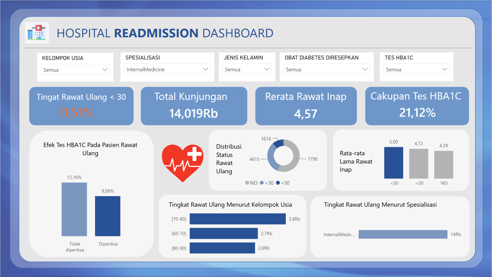

# Hospital Readmission & Diabetes Care Quality Dashboard

[Bahasa Indonesia](README.id.md) · **English**

A monitoring dashboard for the quality of inpatient diabetes care: how large the **30-day readmission rate** is, and which patient groups, specialties, and discharge pathways it is concentrated in.



## Links

|                                  |                                                                                                                                                                                                           |
| -------------------------------- | --------------------------------------------------------------------------------------------------------------------------------------------------------------------------------------------------------- |
| **Interactive dashboard (16:9)** | https://app.powerbi.com/groups/me/reports/cdb10212-907d-4ca6-bc72-5d907ea2ed48/d6e66cc0c60110b99211?experience=power-bi                                                                                   |
| **Full-length dashboard**        | https://USERNAME.github.io/REPO-NAME/dashboard/hospital_readmission_dashboard.html                                                                                                                        |
| **Dataset**                      | [`data/diabetes_130_hospitals.xlsx`](data/diabetes_130_hospitals.xlsx) · original source: [UCI ML Repository #296](https://archive.ics.uci.edu/dataset/296/diabetes+130-us+hospitals+for+years+1999-2008) |

> Replace `USERNAME` and `REPO-NAME` with your GitHub account and repository name once GitHub Pages is enabled.

The filters (age, specialty, discharge disposition, gender, HbA1c test, diabetes medication) apply to every KPI and chart. Note that the dashboard interface text is in Indonesian.

---

## 1. Business Problem

> What is the 30-day readmission rate for diabetes patients, and which patient groups, specialties, and discharge pathways account for most of it, so that quality-improvement effort can be targeted instead of spread evenly across all units?

A quick return to hospital after discharge signals inadequate care or discharge planning, and in many health systems it is a quality indicator that carries financial penalties.

**Five analytical questions**

1. What is the overall 30-day readmission rate?
2. Which specialty has the highest rate?
3. Which discharge disposition is the riskiest?
4. Do patients who received an HbA1c test show a different readmission rate?
5. Which age group is at the highest risk?

**Users and decisions**

| User                                      | Decision supported by the dashboard                                    |
| ----------------------------------------- | ---------------------------------------------------------------------- |
| Hospital quality management               | Set priorities for quality-improvement programs across units           |
| Department / specialty heads              | Compare their unit with the hospital average and set reduction targets |
| Case management / discharge planning team | Decide which transfer pathways need a stricter handover protocol       |

## 2. Dataset

**Diabetes 130-US Hospitals for Years 1999–2008**: 101,766 inpatient encounters of diabetes patients across 130 US hospitals, from 71,518 unique patients.

| Sheet                       | Content                                    | Rows × Columns |
| --------------------------- | ------------------------------------------ | -------------- |
| `encounters`                | Inpatient encounters (1 row = 1 encounter) | 101,766 × 50   |
| `map_admission_type`        | Admission type codes                       | 8 × 2          |
| `map_discharge_disposition` | Discharge disposition codes                | 30 × 2         |
| `map_admission_source`      | Admission source codes                     | 25 × 2         |
| `Kamus_Data`                | Data dictionary (in Indonesian)            | 33 × 4         |

The data content is unchanged; the three code tables are placed on separate sheets. All cleaning is done in the analysis layer (see section 4).

**License & citation:** CC BY 4.0.
Strack, B., DeShazo, J.P., Gennings, C., Olmo, J.L., Ventura, S., Cios, K.J., & Clore, J.N. (2014). _Impact of HbA1c Measurement on Hospital Readmission Rates: Analysis of 70,000 Clinical Database Patient Records._ BioMed Research International, 2014.

## 3. Data Quality Findings

| Table · Column                            | Finding                                                           | Evidence                                                              | Handling                                                  |
| ----------------------------------------- | ----------------------------------------------------------------- | --------------------------------------------------------------------- | --------------------------------------------------------- |
| encounters · `weight`                     | Missing values written as `?`, not as empty cells                 | 96.86%                                                                | Column dropped                                            |
| encounters · `medical_specialty`          | Missing as `?`                                                    | 49.08%                                                                | Explicit "Not Recorded" category (not deleted or imputed) |
| encounters · `payer_code`                 | Missing as `?`                                                    | 39.56%                                                                | "Not Recorded" category                                   |
| encounters · `race`                       | Missing as `?`                                                    | 2.23%                                                                 | "Not Recorded" category                                   |
| encounters · `A1Cresult`, `max_glu_serum` | `None` = test not performed (meaningful, not random)              | 83.3% and 94.7%                                                       | Kept as a category; `a1c_tested` flag created             |
| encounters · `examide`, `citoglipton`     | Single constant value ("No") in every row                         | 1 unique value                                                        | Columns dropped                                           |
| encounters · `discharge_disposition_id`   | Expired / Hospice / Not Mapped codes cannot produce a readmission | 7,103 rows (6.98%)                                                    | Removed from the denominator                              |
| encounters · `patient_nbr`                | 1 row = 1 **encounter**, not 1 patient                            | 101,766 encounters vs 71,518 patients (max 40 encounters per patient) | All indicators are computed **per encounter**             |
| encounters · `gender`                     | Invalid value "Unknown/Invalid"                                   | 3 rows                                                                | Excluded from the gender breakdown only                   |
| map tables · `description`                | Empty descriptions for some codes                                 | `admission_type_id` 6, `discharge_disposition_id` 18                  | Code 18 is excluded (see above)                           |

## 4. Analytical Approach

**Cleaning steps (row audit trail)**

| #   | Action                                                                    | Rows before → after                  |
| --- | ------------------------------------------------------------------------- | ------------------------------------ |
| 1   | Exclude 9 ineligible discharge codes (11, 13, 14, 18, 19, 20, 21, 25, 26) | 101,766 → **94,663** (−7,103)        |
| 2   | Turn `?` in race, medical_specialty, payer_code into an explicit category | 94,663 → 94,663                      |
| 3   | Drop columns `weight`, `examide`, `citoglipton`                           | 94,663 → 94,663                      |
| 4   | Join the 3 code tables (many-to-one on unique keys)                       | 94,663 → 94,663 (no row duplication) |
| 5   | Derived columns                                                           | 94,663 → 94,663                      |

No numeric column is imputed, so no artificial shift is introduced into any indicator.

**Derived columns:** `readmit_30` (1 if `readmitted = "<30"`), sortable age group, `a1c_tested`, `med_change`, ICD-9 diagnosis category (circulatory, respiratory, digestive, diabetes, etc.), number of encounters per patient, and text descriptions from joining the three code tables.

**Data model (star schema):** one fact table, `FactKunjungan` (1 row = 1 eligible encounter), with patient, discharge, admission, and diagnosis/treatment dimensions. This avoids repeating description text across tens of thousands of rows, makes filtering easier, and lets every figure be traced back to its source table and column.

**Indicator dictionary**

| Indicator                                 | Formula                                         | Unit        | Direction        |
| ----------------------------------------- | ----------------------------------------------- | ----------- | ---------------- |
| 30-Day Readmission Rate                   | Σ(`readmitted` = "<30") ÷ Σ eligible encounters | %           | Lower is better  |
| HbA1c Test Coverage                       | Σ(`A1Cresult` ≠ "None") ÷ Σ encounters          | %           | Higher is better |
| Average Length of Stay (LOS)              | Σ `time_in_hospital` ÷ number of encounters     | days        | Context          |
| Average Number of Medications             | Σ `num_medications` ÷ number of encounters      | medications | Context          |
| Readmission Rate by Specialty             | Indicator 1 split by `medical_specialty`        | %           | Lower is better  |
| Readmission Rate by Discharge Disposition | Indicator 1 split by `discharge_desc`           | %           | Lower is better  |

Example DAX implementation (Power BI):

```dax
30-Day Readmission Rate =
DIVIDE(
    CALCULATE(COUNTROWS(FactKunjungan), FactKunjungan[readmit_30] = 1),
    COUNTROWS(FactKunjungan),
    0
)

HbA1c Test Coverage =
DIVIDE(
    CALCULATE(COUNTROWS(FactKunjungan), FactKunjungan[a1c_tested] = 1),
    COUNTROWS(FactKunjungan),
    0
)
```

**Dashboard design:** 4 KPIs on top and six charts below (age, specialty, discharge disposition, readmission status distribution, HbA1c test effect, LOS & medications). Bar charts start at zero, titles state the finding, brick red consistently marks the highest/riskiest value, and the donut is used only for 2 categories.

**Reconciliation:** KPI values were recomputed independently from the raw table and compared with the dashboard.

| Indicator                                    | Independent calculation   | Dashboard |
| -------------------------------------------- | ------------------------- | --------- |
| 30-day readmission (eligible basis)          | 10,763 / 94,663 = 11.37%  | 11.37% ✓  |
| 30-day readmission (raw basis, no exclusion) | 11,357 / 101,766 = 11.16% | 11.16% ✓  |
| Unique patients                              | 71,518                    | 71,518 ✓  |

The gap between 11.16% and 11.37% comes entirely from excluding the 7,103 encounters that cannot result in a readmission; without that exclusion the readmission rate looks misleadingly low.

## 5. Key Findings

| #   | Finding                                                                       | Figures                                                                |
| --- | ----------------------------------------------------------------------------- | ---------------------------------------------------------------------- |
| 1   | Patients transferred to a rehab facility are the most likely to be readmitted | **27.70%** (n=1,993) vs 9.30% when discharged home                     |
| 2   | Nephrology is the highest among recorded specialties                          | **16.13%** (n=1,500) vs 11.37% overall; Cardiology 8.04%               |
| 3   | Patients aged 20–30 are at higher risk than older adults                      | **14.42%** (n=1,595) vs 12.05% for ages 70–80                          |
| 4   | HbA1c test coverage is low, and tested patients are readmitted less           | Coverage **16.92%**; readmission 9.82% (tested) vs 11.68% (not tested) |
| 5   | The <30-day readmission group has a longer LOS and more medications           | LOS 4.73 vs 4.18 days; medications 16.90 vs 15.56                      |

Answer to the first analytical question: the overall 30-day readmission rate is **11.37%** (10,763 of 94,663 encounters).

## 6. Recommendations

| Owner                                      | Action                                                                                                                    | Supporting figure                          | Monitoring indicator                                 |
| ------------------------------------------ | ------------------------------------------------------------------------------------------------------------------------- | ------------------------------------------ | ---------------------------------------------------- |
| Nephrology unit head & quality team        | Audit discharge-planning protocols and medication-adherence education                                                     | 16.13% vs 11.37%                           | Monthly Nephrology 30-day readmission rate           |
| Case management team                       | Strengthen transitions (follow-up appointments, home-health follow-up) for patients referred to rehab or another hospital | 27.70% and 16.07% vs 9.30%                 | Readmission rate by discharge disposition, quarterly |
| Clinical quality committee / endocrinology | Expand the policy of testing HbA1c before discharge                                                                       | Coverage 16.92%; 1.86 percentage-point gap | % of encounters with `A1Cresult` recorded            |

## 7. Limitations

- **The relationships are correlational, not causal.** Patients transferred to rehab/SNF tend to be sicker from the start, and patients who are routinely tested for HbA1c may simply be better controlled.
- **There is no encounter date**, only length of stay. Monthly/yearly trends and a calendar time dimension cannot be built, so the trend question is left open.
- **There is no hospital identifier**, so hospitals cannot be compared with each other; the analysis is aggregate.
- The data covers 1999–2008 from 130 hospitals with varying recording practices (visible in the 49% of encounters with no recorded specialty). Readmissions to hospitals outside the data system are not captured, so the true rate is probably higher.
- Excluding 7,103 encounters raises the measured rate from 11.16% to 11.37%; compare with other sources only when the denominator is the same.
- The per-specialty findings apply only to encounters whose specialty was recorded.

## 8. Implementation Note for Power BI

The dashboards in this repo are HTML/JavaScript prototypes containing aggregated data from the analysis above. Power BI does not run custom JavaScript directly, so for a production version, rebuild it with native visuals (Card, Bar chart, Donut, Slicer) on top of the star schema, using DAX measures like the examples above.

## Repository Structure

```
├── README.md                        # English
├── index.html                       # redirect to the dashboard (for GitHub Pages)
├── dashboard/
│   ├── hospital_readmission_dashboard_16x9.html
│   └── hospital_readmission_dashboard.html
├── data/
│   └── diabetes_130_hospitals.xlsx
└── docs/images/dashboard_preview.png
```
